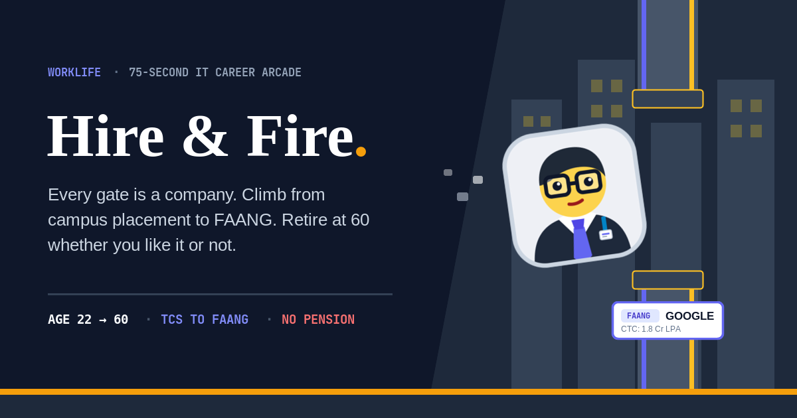

# WorkLife — Hire & Fire

**A satirical 75-second arcade simulation of an Indian IT career.**  
*Every gate is a company. Climb from campus placement to FAANG. Retire at 60 whether you like it or not.*

  

---

## The Idea Behind It

A typical corporate career spans nearly four decades — starting fresh out of college at 22, navigating service bonds, hoping for onsite opportunities, surviving annual bell-curve appraisals, hopping from service-based giants to consulting firms and product companies, and eventually reaching retirement at 60.

**WorkLife — Hire & Fire** compresses that entire 38-year working life into **75 relentless seconds**. Inspired by classic one-button arcade mechanics and the dry, shared humor of Indian tech corridors (Pune, Bengaluru, Hyderabad, Gurugram, Noida, Chennai, and Mumbai), every vertical obstacle is a company gate, every cleared gate bumps your CTC package in LPA/Cr, and every collision writes your corporate exit interview. Even if you dodge every layoff and burnout trap, the wall-clock reaches Age 60 at the 75-second mark — locking your controls and handing you the inevitable verdict: **"Retired at 60. No pension."**

---

## About the Game

### 1. 75-Second Career Clock (Age 22 → 60)
- **Wall-Clock Pacing**: Your working life advances from **22.0 to 60.0** over 75 real-time seconds, shifting the cyber-park skyline from bright daytime campus induction to late-night overtime crunch as you approach seniority.
- **Graduated Industry Arc**:
  - **Ages 22–31 (Mass Hiring Circuit)**: *TCS, Infosys, Wipro, Tech Mahindra, Cognizant, Capgemini, Accenture, HCLTech*
  - **Ages 31–41 (MNC Wave)**: *IBM, Concentrix, Genpact* alongside senior service roles
  - **Ages 41–51 (Consulting & Big 4)**: *Deloitte, KPMG, EY, PwC*
  - **Ages 51–60 (FAANG Gauntlet)**: *Amazon, Microsoft, Google, Meta, Apple, Netflix* with multiplicative LPA/Cr package jumps

### 2. Candidate Customization & Career Tracks
- **Custom Employee Name**: Enter your own name before starting so your career logbook, exit interview, retirement decree, and official relieving certificate belong to you.
- **Procedural Avatars**: Choose between **Rahul M.** and **Ananya S.** — drawn completely in Canvas 2D with corporate blazers, crisp collars, ties, spectacles, ID lanyards, blinking animations, and velocity tilt physics.
- **Three Starting Tracks**:
  - **Fresher** (`₹3.6 LPA` starting base) — *First offer letter. Family is proud. Bond period included.*
  - **Associate** (`₹8.5 LPA` starting base) — *Two appraisals in. Still writing "as per my last email".*
  - **Expert** (`₹24.0 LPA` starting base) — *Ten years in. You interview the freshers who replaced you.*

### 3. Mid-Career Satirical Pop-Up Events
As the clock ticks upward, transient corporate banners surface mid-flight without blocking your lane:
- **Bond Period Active** — *2-year service agreement locked. Penalty: ₹2,00,000.*
- **Mandatory Return-to-Office** — *5 days in office. Badge swipes linked to payroll.*
- **Annual Appraisal: Rating 2.5/5** — *Bell-curve normalization applied.*
- **Pizza Party Announced** — *Record $1.2B profit celebrated with 2 cheese slices.*
- **Client P1 Sev-1 Escalation**, **PIP Protocol Initiated**, **Organizational Restructuring**, and **FAANG Recruiter InMail**.

### 4. Relieving Slip & Full & Final Settlement
Whether your run ends via a company collision, office floor burnout, glass ceiling crash, or mandatory retirement at 60, the game generates an official **Service Certificate & Relieving Slip** issued under the **last company you worked in** (complete with its legal entity name, registered campus address, CIN/LLPIN, brand seal, and verification via the *WorkLife IT Solutions* alumni registry):
- **Copy Text** to clipboard
- **Print / Save as PDF** with an isolated A4 print layout
- **Download A4 Letter (Image)** rendered at `1240×1754` (150 DPI A4) with handwritten HR signature and crimson approval stamp

### 5. Zero-Asset Procedural Engine & Web Audio
- **100% Procedural Canvas 2D & Web Audio**: No external sprite sheets, sound files, or server dependencies. Every character expression, office tower, corporate nameplate, paper-flutter particle, 120 BPM corridor pulse bed, flap blip, gate chime, and retirement chord is synthesized live in the browser.
- **Local Career Logbook**: Tracks personal bests per track and archives your recent career attempts in `localStorage`.

---

## Visual Assets & Favicons (`public/assets/`)

| Asset | Preview | Purpose |
| :--- | :---: | :--- |
| `favicon.svg` |  | Adaptive flat-vector icon with light/dark tab contrast |
| `android-chrome-192x192.png` |  | Android / Web App Manifest icon (`192×192`) |
| `android-chrome-512x512.png` |  | High-res launcher & splash icon (`512×512`) |
| `apple-touch-icon.png` |  | Full-bleed iOS home screen icon (`180×180`) |
| `favicon-32x32.png` / `16x16` |  | Crisp supersampled desktop browser favicons |
| `favicon.ico` | — | Multi-resolution legacy ICO bundle (`16/32/48px`) |
| `og-banner.png` | — | `1200×630` OpenGraph & Twitter/X link preview banner |

---

## Tech Stack

- **UI & State**: React 19, TypeScript, Tailwind CSS v4, Lucide Icons
- **Game Engine**: Custom 60 FPS Canvas 2D physics & procedural renderer
- **Audio**: Native Web Audio API synthesizer
- **Build Tooling**: Vite

---

## Creator

**Chirantan Mallick**

- **Portfolio**: [chirantanmallick.vercel.app](https://chirantanmallick.vercel.app)
- **GitHub**: [github.com/spicychief05](https://github.com/spicychief05)
- **Phone**: [+91 8327438929](tel:+918327438929)
- **Email**: [mallickchirantan@gmail.com](mailto:mallickchirantan@gmail.com)
